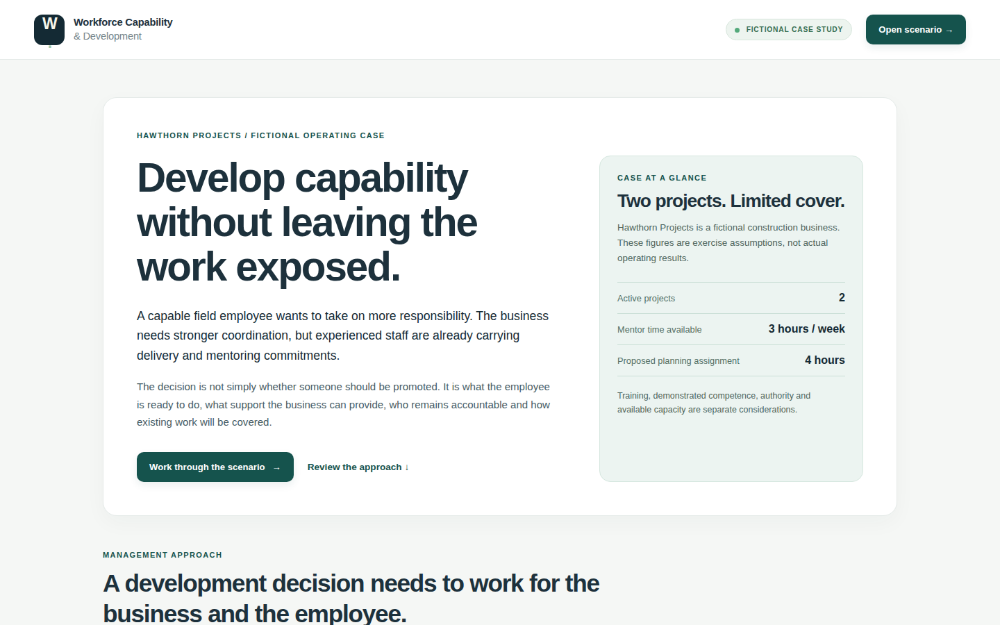
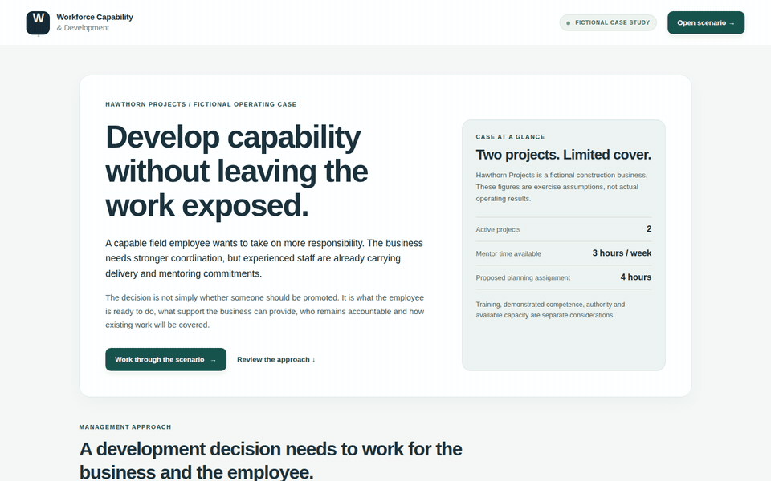

# Workforce Capability & Development

**Leadership Studio** is an interactive leadership and organisational-development case for exploring how people development affects delivery, succession and management accountability.

This is an operations-management portfolio project, not an HR product. All people, evidence and operating figures are fictional.

[**Open the live Leadership Studio →**](https://nathantaylorops.github.io/workforce-capability-development/) · [Source code](https://github.com/NathanTaylorOps/workforce-capability-development) · [Verification](https://github.com/NathanTaylorOps/workforce-capability-development/actions)

## The management problem

A capable employee wants to develop. The business needs stronger coordination. But experienced people are already stretched, delivery commitments cannot simply be ignored, and completing training does not automatically establish competence or authority.

Taking the General Manager's position in fictional **Hawthorn Projects**, the visitor explores what support the organisation can provide and how different decisions affect the employee, the workload and the wider team.

**The question isn't just whether someone is ready for more responsibility. It's whether the business is ready to support that responsibility properly.**

## Explore the scenario

The guided six-stage case lets you:

1. Assess the employee's existing strengths, ambitions and the business's operating position.
2. Explore different development directions rather than assuming everyone should progress into supervision.
3. Allocate mentoring, address management commitments and record a fictional weekly review.
4. Examine observed competence and separate training from demonstrated capability and delegated authority.
5. Consider delivery cover, succession, key-person dependency and organisational capacity before selecting a management response.
6. Review the consequences, compare two independent decisions from the same starting conditions, and preview or print a management decision brief.

The program uses deterministic rules. It does **not** automatically rank employees, infer suitability from personal traits or approve work.

### Actual product walkthrough

<strong>View the individual screenshots</strong>

| View | Screenshot |
| --- | --- |
| Operating case | [Overview](docs/media/01-overview.png) |
| Employee and career direction | [Employee](docs/media/02-employee.png) · [Development pathways](docs/media/03-development-pathways.png) |
| Capability evidence | [Assessment](docs/media/04-competency-evidence.png) |
| Accountable decision | [Management decision](docs/media/05-accountable-decision.png) |
| Consequences | [Outcome](docs/media/06-outcome.png) |
| Alternative management choices | [Two-decision comparison](docs/media/07-compare-decisions.png) |
| Printable management record | [Decision brief](docs/media/08-management-brief.png) |
| Responsive interface | [Mobile](docs/media/09-mobile-overview.png) |

All images and GIF frames come from real Chromium browser interactions with this application and use synthetic scenario data. The [capture script](scripts/capture-showcase.mjs) can reproduce them.

## Why build this?

SMEs often depend heavily on their most experienced people. Better systems make skills, operating commitments, resource constraints and knowledge-transfer gaps visible. They create room for better decisions; they do not remove the need for experience, leadership or human judgment.

This project explores the connection between developing people and building an organisation that can grow without becoming increasingly dependent on a handful of individuals.

## Scope and limits

- This is **one synthetic, simplified leadership case**, not a multi-company workforce platform.
- Every character, observation, assignment, hour and outcome is invented. Figures are not measured ROI or actual workforce data.
- Simplified evidence thresholds are teaching assumptions, not legal, licensing or industry standards.
- **Trained ≠ competent ≠ authorised.** Hiring, promotion, discipline, safety-critical work and legal obligations require qualified human assessment.
- No backend, accounts, analytics tracking, personal-data collection or persistent scenario state. Reset clears the active scenario.
- Accessible interface patterns and desktop/mobile smoke checks are included, but independent accessibility and usability certification are not claimed.

## Verified build and deployment

The current **main** branch includes the merged [management decision brief (PR #34)](https://github.com/NathanTaylorOps/workforce-capability-development/pull/34), two-decision comparison and an operating overview. The **v0.9.0 tag is an older release baseline**, not a claim that newer features are in that tag.

- [Application checks](https://github.com/NathanTaylorOps/workforce-capability-development/actions/workflows/ci.yml)
- [GitHub Pages deployment](https://github.com/NathanTaylorOps/workforce-capability-development/actions/workflows/pages.yml)
- [Published desktop/mobile Chromium smoke test](https://github.com/NathanTaylorOps/workforce-capability-development/actions/workflows/live-smoke.yml)

The tests exercise real browser interactions and live HTTPS loading. They do not constitute a full security review or formal accessibility audit.

## Run locally

A static server is sufficient for the application:

~~~bash
python3 -m http.server 8080
~~~

Open http://localhost:8080. The application itself has no npm dependencies.

For scenario tests and syntax checks, use Node.js 20+:

~~~bash
npm run check
~~~

CI separately runs Chromium interactions using a pinned browser test dependency.

## Implementation and references

- **Interface:** index.html, styles.css, src/overview.js
- **Scenario:** src/data.js, src/engine.js
- **Application:** src/app.js
- **Decision comparison and records:** src/management-comparison.js, src/management-compare-view.js, src/decision-brief.js
- **Tests:** tests/ and GitHub Actions workflows
- [Project charter](docs/PROJECT_CHARTER.md) · [Roadmap](docs/ROADMAP.md) · [Working agreement](docs/WORKING_AGREEMENT.md) · [Data and evidence policy](docs/DATA_AND_EVIDENCE.md)
- [Development history](docs/DEVELOPMENT_HISTORY.md) — prior milestones, historical verification and its limitations

**Maintainer:** [NathanTaylorOps](https://github.com/NathanTaylorOps).
